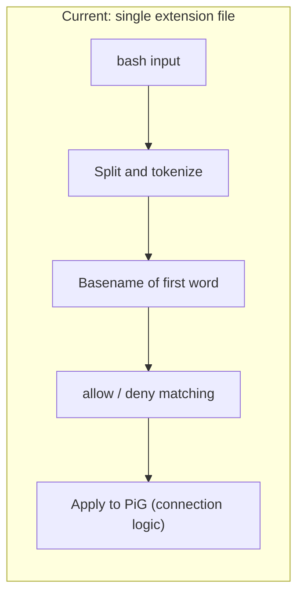
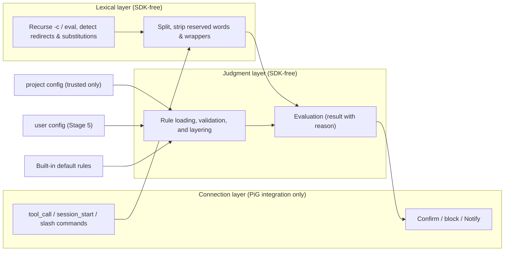
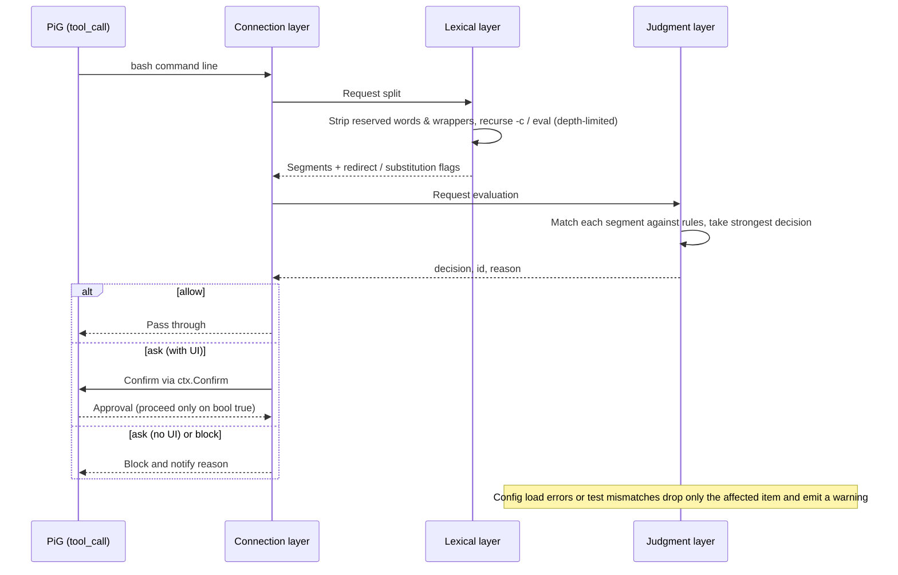

# Adopt a `permissionRules`-Style Rule Format for `command-policy`

- **Date**: 2026-11-21
- **Target**: `command-policy` extension in `pigpen-command-policy` (for the PiG 0.7.0 Go SDK)
- **Status**: Decisions 1–6 are settled per the options selected in the planning memo. No open decisions remain.
- **Source**: Planning memo "Implementation approach for adding `permissionRules`-equivalent functionality to `command-policy`" (as of 2026-11-21), translated from the original Japanese design document.

This document is written to be self-contained and includes the prerequisite investigation findings.

## Background

### Current `command-policy`

The PiG extension `command-policy` evaluates each `tool_call` for the `bash` tool.

- **Configuration**: `<cwd>/.pig/command-policy.json` specifies `allow` and `deny` (both lists of program names) and `onUnlisted` (`ask` / `allow` / `deny`).
- **Loading**: Re-read on every `bash` invocation. If the file is missing or malformed, defaults are used. If a non-empty list is configured, it replaces the entire default list.
- **Evaluation**: Splits the command line on delimiters (`|`, `;`, `(`, `)`, backticks, newlines, `&`) and tokenizes into words. Skips leading `VAR=value` assignments and 6 wrappers (`command`, `builtin`, `exec`, `nohup`, `nice`, `time`), then inspects only the basename of the first word. If any segment matches `deny`, the result is `deny`; if all match `allow`, the result is `allow`; otherwise `onUnlisted` applies.
- **PiG integration**: `allow` passes through. `deny` blocks execution and emits a warning. `ask` prompts via `ctx.Confirm` when a UI is available and proceeds only when the return value is boolean `true`; without a UI, it blocks.

### Existing Problem: Denied Programs Pass Through

Verified on 2026-11-21 by feeding the following inputs into the current parser. The default `deny` list includes `echo` and `printenv`, so these examples should be stopped. "Default" refers to the default `onUnlisted: ask`, and "`onUnlisted: allow`" refers to changing only `onUnlisted` to `allow`.

| Command | Extracted program names | Default | `onUnlisted: allow` |
| --- | --- | --- | --- |
| `if true; then echo hi; fi` | `if` `then` `fi` | ask | allow |
| `for i in 1; do printenv; done` | `for` `do` `done` | ask | allow |
| `{ echo hi; }` | `{` `}` | ask | allow |
| `nice -n 5 echo hi` | `-n` | ask | allow |
| `time -p printenv` | `-p` | ask | allow |
| `sudo echo hi` | `sudo` | ask | allow |
| `bash -c 'echo hi'` | `bash` | ask | allow |
| `xargs echo < f` | `xargs` | ask | allow |
| `cat a > b` | `cat` | allow | allow |
| `/usr/bin/env` | `env` | deny | deny |

With the default `onUnlisted: ask`, a confirmation dialog appears, so commands are not executed silently. However, the guarantee that "anything listed in `deny` is always stopped" is broken. In projects configured with `onUnlisted: allow`, these commands execute without confirmation. `cat a > b` demonstrates that an allowed program alone can overwrite files.

### Reference Mechanism: Droid's `permissionRules`

Droid 1.12.1's `permissionRules` serves the same purpose. Verified on 2026-11-21 using `droid rules check --file <rules.json> --command '<cmd>' --json`:

- A rule has `id`, `decision` (`allow` / `ask` / `block`), `reason`, `match.prefix`, and `tests` (`match` and `noMatch`).
- A rule with `prefix: ["env"]` fails `tests.match: ["env"]` and is skipped. Bare `env` evaluates to no-match. In other words, Droid's specification cannot express a rule that blocks bare `env` with no arguments.
- `env echo hi`, `nice -n 5 echo hi`, `time -p echo hi`, `if true; then echo hi; fi`, and `{ echo hi; }` all match a `block` rule with `prefix: ["echo"]`.
- `/bin/echo hi` is no-match.
- Adding `onUnlisted` to a rules file is accepted by `droid rules check --file` with no warnings and exit code 0.

Key differences from Droid:

- **Matching**: Droid allows per-position alternatives (`["git", ["push", "pull"]]`). The current `command-policy` inspects only the first word.
- **Wrappers**: Droid strips wrappers for `ask` / `block` evaluation, and does not strip them for `allow`. Currently, `command-policy` always strips 6 wrappers and fails to strip them when flags are present.
- **Shell syntax**: Droid also evaluates the bodies of `if` / `for`, `{ }`, `bash -c`, `eval`, and `find -exec`. Currently, reserved words and braces are not stripped, and `bash -c` bodies are not inspected.
- **Config layering**: Droid layers Org > Runtime > Folder > Project > User, where higher layers win on matching `id`. Loading Project config requires workspace trust. Currently, only a single project file is read, without checking trust.

### PiG SDK Constraints

Capabilities available in the SDK as of 2026-11-21 (`sdk-51955af53b263ab7`):

- `ctx.IsProjectTrusted() (bool, error)`: Returns an error on communication failure; errors are not treated as trusted.
- `ctx.ConfigHome() (string, error)`: Resolves in order: `PIG_HOME`, `XDG_CONFIG_HOME/pig`, `~/.pig`.
- `e.RegisterCommand(name, sdk.CommandOptions{Description, Handler})`: Registers a slash command.
- `ctx.Confirm(title, message) (any, error)`: Displays a confirmation dialog.

PiG's `tool_call` has no return value equivalent to Droid's `permissionDecision: "ask"`. Therefore, for `ask`, the extension itself must invoke `ctx.Confirm`.

## Objective (Project Goal)

Redesign `command-policy` evaluation so each rule carries `id`, `decision`, and `reason`, while closing the bypasses that allow denied programs to slip through. Enable the same evaluation outcomes from rule files using the same format as Droid's `permissionRules`.

## Expected Impact

- The guarantee that "anything in `deny` is stopped" holds regardless of the `onUnlisted` setting.
- Users can see why a command was stopped (which rule and its `reason`).
- Configuration mistakes (misspelled `id`, rules failing self-tests) surface as warnings instead of silently failing to take effect.

No quantitative target metrics are specified in the planning memo, so none are listed here.

## Scope (In Scope)

- Strip shell reserved words (`if`, `then`, `for`, `do`, `{`, `}`, etc.) from the start of segments before evaluation.
- Strip `sudo`, `doas`, `env`, `timeout`, `nohup`, `nice`, `time`, `command`, `builtin`, `exec`, `xargs`, and `VAR=value` assignments along with their flags and arguments. For `ask` / `block` evaluation, match against both the token sequence before stripping and the sequence after stripping.
- Recursively evaluate arguments to `bash` / `sh` / `zsh` `-c` and `eval` as command lines, with a recursion depth limit.
- Read the `{version, rules, onUnlisted}` rule format, perform `match.prefix` matching, enforce `allow` / `ask` / `block`, and display `reason`.
- Restrict `allow` matching: do not apply `allow` rules when redirects, command substitutions, or wrappers are present.
- Do not read the legacy format (`allow` / `deny` lists) (Decision 6).
- Self-test rules. Detect unknown fields, missing required fields, invalid `decision` values, and duplicate `id`s within the same config source. Skip rules whose `tests` fail and emit a warning.
- Layer three config sources: `project`, `user`, and `builtin`. Loading `user` config is delivered in Stage 5.
- Protect built-in `deny` rules (`echo`, `printenv`, `env`, etc.). They cannot be overridden by a `user` config with the same `id` and cannot be disabled with `enabled: false`.
- Read `project` config only when the project is trusted (`IsProjectTrusted()` returns `true`). When untrusted (`false` or error), do not read `project` config; commands matching built-in or `user` rules follow their decisions, and anything unmatched is blocked regardless of `onUnlisted`. Notify the user accordingly.
- Add `/command-policy check <command>` and bare `/command-policy`.
- Turn the measured bypass table above into table tests under `go test`. Document intentional divergences from Droid in comments within the tests.

## Non-Goals (Out of Scope)

- Droid's Org / Runtime / Folder layers and multi-tier `enabled` overrides. Config sources are limited to `project`, `user`, and `builtin`.
- Droid's autonomy-based risk judgment. No-match cases are decided by `onUnlisted`, because PiG has no equivalent mechanism.
- Extracting the judgment logic into a standalone CLI, including invocation from other agents such as claude or grok (Decision 5).
- Directly reading Droid's settings file (`~/.factory/settings.json`) (Option B of Decision 4 is not adopted).
- Full shell parsing. Variable expansion, shell functions, and here-doc bodies are not evaluated. `-c` and `eval` use depth-bounded recursion only.
  - *Assumption*: This boundary was not explicitly stated in the planning memo; the depth limit and the scope above are set as explicit assumptions.
- Automatic migration of existing `.pig/command-policy.json` files in the legacy `allow` / `deny` list format (Decision 6). Only the new format is read.

## Overview

Evaluation is separated into three layers:

- **Connection layer**: Integration with PiG. Handles event registration, slash commands, `ctx.Confirm` / block responses, and notifications. This is the only layer that imports the PiG SDK.
- **Judgment layer**: Handles rule loading, validation, source layering, and evaluation. Does not import the PiG SDK.
- **Lexical layer**: Handles command-line splitting, word tokenization, reserved-word and wrapper stripping, `-c` and `eval` expansion, and redirect / command-substitution detection. Does not import the PiG SDK.

Evaluation flow:

1. The lexical layer splits the command line into segments and strips reserved words and wrappers. The bodies of `-c` and `eval` are recursively split using the same procedure.
2. The judgment layer matches each segment against rules. For `ask` / `block`, the first word is matched by basename; for `allow`, the original token is matched. `allow` is not applied if redirects, command substitutions, or wrappers are present.
3. For each segment, the judgment layer takes the strongest `decision` among matched rules. If any segment matches no rule, the `onUnlisted` decision is included. The strongest decision across all segments becomes the final result.
4. The connection layer acts on the decision: pass through (`allow`), prompt for confirmation (`ask`), or block and show the reason (`block`).

Decision strength is ordered `allow < ask < block`. Representing it as an integer type allows taking the strongest decision in a single `max`.

Example configuration (Droid's format with `onUnlisted` added; this file can be verified with `droid rules check --file`):

```json
{
  "version": 1,
  "onUnlisted": "ask",
  "rules": [
    {
      "id": "project/git-push",
      "decision": "ask",
      "reason": "push changes the remote, so confirm",
      "match": { "prefix": ["git", "push"] },
      "tests": {
        "match": ["git push origin main"],
        "noMatch": ["git status"]
      }
    }
  ]
}
```

## Map of Changes

### Boundaries and Diff (Static)

The architecture is shown as two Mermaid `flowchart` diagrams (before and after).

<details>
<summary>Mermaid source (before: current structure)</summary>



</details>

<details>
<summary>Mermaid source (after: target structure)</summary>



</details>

Summary of differences:

- **Added**: Judgment layer and lexical layer, neither depending on the PiG SDK.
- **Changed**: Connection layer shrinks to handle only PiG integration.
- **Changed**: Config loading now includes rule-format validation. Default rules are held as built-in rules instead of replacing defaults wholesale when a list is configured.
- **Unchanged**: Dependencies and tasks; no new external dependencies are added.
- **Changed**: Legacy `allow` / `deny` list configs are no longer read (Decision 6).

### Data Flow (Dynamic)

<details>
<summary>Mermaid source</summary>



</details>

### State and Completion (Behavior)

Omitted. Rules have no long-lived state; validity is determined on each load, so there is no state transition diagram to draw.

## Detailed Design

### Key Design Decisions and Trade-offs

Decisions 1–6 are based on the answers to the "Decisions needed" items in the planning memo. The "Scenarios considered" column supplements the answers so readers can follow the reasoning behind each choice.

| Topic | Decision | Scenarios considered (why avoided / what is accepted) | Revisit when |
| :--- | :--- | :--- | :--- |
| Decision 1: How to handle wrappers such as `env` | Match both the token sequence before stripping and after stripping (Option B) | With Droid's approach, bare `env` is no-match, rendering the default `env` deny rule ineffective and allowing bare `env` to dump environment variables. / Accepted: commands like `env ls` that match before or after stripping are also stopped. Divergence from Droid is strictly in the stricter direction. | Exact parity with Droid's evaluation results is required, or blocking `env` disrupts normal user workflows. |
| Decision 2: How to handle absolute paths | Match by basename for `ask` / `block`; match by original token for `allow` (Option B) | Basename-only matching for `allow` would let `/tmp/x/ls` match an `ls` allow rule, allowing arbitrary executables with the same name to run without confirmation. / Accepted: existing test case `/usr/bin/ls` moves from `allow` to `onUnlisted` (default `ask`). | Users find confirmation prompts burdensome due to frequent legitimate absolute-path executions. |
| Decision 3: How to handle rules failing `tests` | Skip only the failing rule and emit a warning (Option A) | Failing the entire policy on a single failing rule would turn every command into `ask` due to one typo in config. / Accepted: skipping a `block` rule loosens enforcement for that rule, mitigated by surfacing warnings (`session_start` notification and status display). | A skipped `block` rule goes unnoticed in practice; revisit failing the entire policy to `ask` (Option B). |
| Decision 4: Where to store rule config | PiG-specific files only (Option A). Load order: `project`, then `user`. Decision strength is determined by logic separate from load order. | Creates dual maintenance alongside Droid settings. / Accepted: because the format matches Droid, moving to a shared file later does not require changing judgment logic. | Users want to share the same file with Droid (reading Droid settings directly, or adopting a cross-agent file). Only the loader source needs to change, not judgment logic. |
| Decision 5: Whether to build a standalone CLI | Do not build one. Use only inside the PiG extension, while keeping the judgment and lexical layers free of PiG SDK imports. | Future demand may arise to use the same judgment from claude or grok. / Accepted: no CLI for now; keeping SDK-free layers allows extraction later. | A second agent requires the same judgment engine. |
| Decision 6: Whether to keep the legacy `allow` / `deny` format | New format only (Option B; breaking change accepted for 0.1.0) | Existing `.pig/command-policy.json` files will stop being read and user settings will stop taking effect. / Accepted: acceptable impact at 0.1.0. | Real users with existing legacy configs are found to need migration support. |
| Source layering and trust | When trusted: read `project` config. When untrusted: do not read `project` config; commands matching built-in or `user` rules follow their decision; anything unmatched is blocked (regardless of `onUnlisted`). Same `id`: higher layer wins. Cross-`id`: `block > ask > allow`. | Prevents `onUnlisted: "allow"` inside a freshly cloned repository from taking effect. / Accepted: in untrusted projects, all `bash` commands not matching built-in or `user` rules are blocked until the user grants trust. | Blocking all unmatched `bash` commands in untrusted projects proves too disruptive to user workflows. |

### Config Format and Validation Policy

- `decision` is one of `allow`, `ask`, or `block`.
- `onUnlisted` defines the behavior on no-match and sits at the top level to match Droid's schema.
- Unknown fields are treated as errors (equivalent to `DisallowUnknownFields`).
- Missing required fields, invalid `decision` values, or duplicate `id`s cause the entire config source to be rejected.
- `tests` are used for matching only and never execute commands. Rules that fail their `tests` are individually skipped.
- All detected problems are collected and emitted as warnings at `session_start`. The status display shows the number of active rules and the number of problems.
- Config is re-read on every `bash` invocation. Because config files are small, re-running `tests` matching on each load is lightweight.

## Non-Interactive Mode

When `pig` runs in non-interactive mode:

- Commands matching `ask` cannot show a confirmation dialog, so they are blocked. Execution never waits for input.
- In untrusted projects, only commands matching built-in or `user` rules proceed; everything else is blocked.
- Trust cannot be granted interactively, so projects that run `bash` non-interactively must be trusted in advance. Otherwise, only matched commands are allowed.

## Implementation Stages

Each stage can be verified independently. Stages 1 and 2 provide immediate value to current users and can ship ahead of the rule-format work.

- **Stage 1: Close `deny` bypasses** (keep the current config format)
  - Verification: The first 8 rows of the "Existing Problem: Denied Programs Pass Through" table evaluate to `deny`. Existing tests pass.
- **Stage 2: Do not read `project` config in untrusted projects**
  - Verification: When `IsProjectTrusted()` returns `false` (or error), `project` config is not used in evaluation; unmatched commands are blocked regardless of `onUnlisted`, and a notification is emitted. When `true`, `project` config is read.
- **Stage 3: Evaluate commands using the rule format**
  - Verification: The measured specification table (verified against Droid) is implemented as table tests and passes completely. Legacy format is not read (Decision 6).
- **Stage 4: Self-test rules and warn on config errors**
  - Verification: Unknown fields, missing required fields, duplicate `id`s, and `tests` mismatches each emit warnings and drop only the affected source or rule.
- **Stage 5: Layer `user` config**
  - Verification: A `user` rule overrides a `builtin` rule with the same `id` and can disable it via `enabled: false`. Built-in `deny` rules cannot be overridden or disabled (verify that `echo hi` remains blocked even with a same-`id` override and `enabled: false`).
- **Stage 6: Add inspection slash commands**
  - Verification: `/command-policy check <command>` displays the decision, the deciding rule's `id` and source, and the list of all matched rules. Bare `/command-policy` displays loaded config sources, active rule count, disabled sources with reasons, and rules failing `tests`.

## Open Questions

None. Decisions 1–6 were finalized per the options column of the planning memo. Decision 6 is Option B (new format only).

## Definition of Done

The stages under "Implementation Stages" define the granularity for splitting into issues. Issue creation is handled in a separate session that reads this document. Stages 1 and 2 can be shipped independently ahead of the rule-format work.
