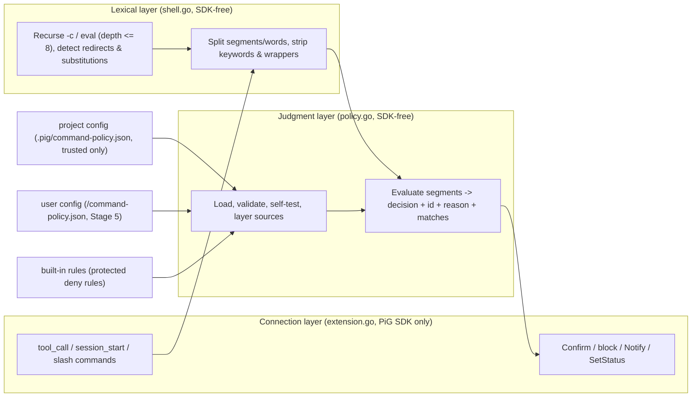
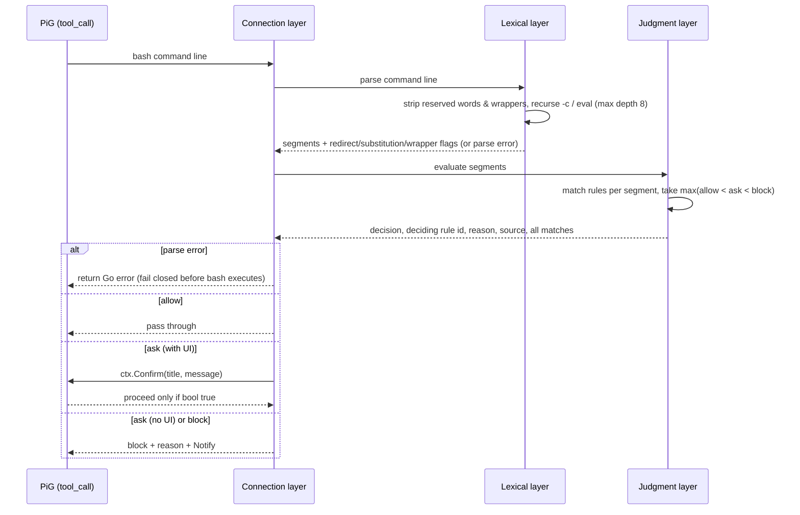

# Design: Port Droid-style `permissionRules` into `command-policy`

## Context

See `proposal.md` for motivation and scope.

### Baseline & Observed Evidence (2026-11-21)

At baseline (`ce2c866`, before Stage 1), `command-policy` read `<cwd>/.pig/command-policy.json` on every `tool_call` for `bash` without checking workspace trust, split commands on shell delimiters, skipped leading `VAR=value` and 6 unflagged wrappers (`command`, `builtin`, `exec`, `nohup`, `nice`, `time`), and checked only the basename of the first word against `allow`/`deny` lists (`defaultPolicy` deny: `printf`, `echo`, `printenv`, `env`; allow: `rg`, `find`, `cat`, `ls`, `sed`, `od`, `wc`, `grep`; `onUnlisted: "ask"`).

Measured bypasses on `ce2c866` (closed in Stage 1 except row 9, which moves to Stage 3):

| Command | Extracted on `ce2c866` | Default (`ask`) | `onUnlisted: allow` | Target Stage |
| --- | --- | --- | --- | --- |
| `if true; then echo hi; fi` | `if` `then` `fi` | ask | allow | Stage 1 (done) |
| `for i in 1; do printenv; done` | `for` `do` `done` | ask | allow | Stage 1 (done) |
| `{ echo hi; }` | `{` `}` | ask | allow | Stage 1 (done) |
| `nice -n 5 echo hi` | `-n` | ask | allow | Stage 1 (done) |
| `time -p printenv` | `-p` | ask | allow | Stage 1 (done) |
| `sudo echo hi` | `sudo` | ask | allow | Stage 1 (done) |
| `bash -c 'echo hi'` | `bash` | ask | allow | Stage 1 (done) |
| `xargs echo < f` | `xargs` | ask | allow | Stage 1 (done) |
| `cat a > b` | `cat` | allow | allow | Stage 3 |
| `/usr/bin/env` | `env` | deny | deny | Regression guard |

### Reference Behavior: Droid 1.12.1 `permissionRules`

Measured on 2026-11-21 via `droid rules check --file <rules.json> --command '<cmd>' --json`:

- Rules have `id`, `decision` (`allow` / `ask` / `block`), `reason`, `match.prefix` (exact string or string-array alternatives per position, e.g. `["git", ["push", "pull"]]`), and `tests` (`match`, `noMatch`).
- A rule with `prefix: ["env"]` is skipped because `tests.match: ["env"]` fails; bare `env` is no-match in Droid.
- `env echo hi`, `nice -n 5 echo hi`, `time -p echo hi`, `if true; then echo hi; fi`, and `{ echo hi; }` all match a `prefix: ["echo"]` block rule.
- `/bin/echo hi` is no-match in Droid.
- Adding top-level `onUnlisted` to a rules file is accepted by `droid rules check --file` with no warnings and exit code 0.

### PiG SDK Constraints (`sdk-51955af53b263ab7`, PiG 0.7.0)

- `ctx.IsProjectTrusted() (bool, error)`: returns an error on communication failure; errors are treated as untrusted.
- `ctx.ConfigHome() (string, error)`: resolves `PIG_HOME`, then `XDG_CONFIG_HOME/pig`, then `~/.pig`.
- `e.RegisterCommand(name, sdk.CommandOptions{Description, Handler})`: registers slash commands with handler `func(ctx sdk.Context, args string) error`.
- `ctx.Confirm(title, message) (any, error)`: interactive confirmation dialog; proceed only when result is bool `true`.
- `tool_call` has no `permissionDecision: "ask"` return value, so the extension invokes `ctx.Confirm` directly and blocks when no UI is present.

## Goals / Non-Goals

**Goals:**

- Split `extensions/command-policy` into three clean layers so the lexical and judgment layers have zero PiG SDK imports.
- Ensure "what is in deny always stops" holds regardless of `onUnlisted`, wrappers, shell keywords, or nested `-c`/`eval`.
- Keep config format verifiable with `droid rules check --file`, documenting intentional stricter divergences in tests.
- Deliver incrementally in 6 independently verifiable stages (Stage 1 already merged via PR #16).

**Non-Goals:**

- Org / Runtime / Folder layers or multi-level `enabled` overrides beyond `project`, `user`, and `builtin`.
- Droid's autonomy risk judgment (PiG has no equivalent; `onUnlisted` handles no-match).
- Standalone CLI or direct reading of `~/.factory/settings.json`.
- Full POSIX/bash grammar: variable expansion, shell functions, aliases, arithmetic commands, here-doc bodies, script files (`bash script.sh`), and `find -exec`.
- Automatic migration of legacy `allow`/`deny` `.pig/command-policy.json` files.

## Architecture

### Three-Layer Separation



### Runtime Evaluation Flow



### Decision Strength & Config Shape

- Decision strength is a totally ordered integer enum: `allow < ask < block`, so combining matches across rules and segments is a single `max`.
- Rules have no long-lived state; config is re-read and validated on every `bash` call (files are small, so re-running `tests` matching is cheap).
- Example Droid-compatible config:

```json
{
  "version": 1,
  "onUnlisted": "ask",
  "rules": [
    {
      "id": "project/git-push",
      "decision": "ask",
      "reason": "push changes the remote, so confirm",
      "match": { "prefix": ["git", "push"] },
      "tests": {
        "match": ["git push origin main"],
        "noMatch": ["git status"]
      }
    }
  ]
}
```

### Supported Wrapper Option Tables (11 Wrappers)

Implemented in Stage 1b (PR #14) and carried forward into `shell.go` in Stage 3:

| Wrapper | Supported execution-prefix syntax |
| --- | --- |
| `command` | `-p`, `--` (informational `-v`, `-V` do not execute operands) |
| `builtin`, `nohup` | `--` |
| `exec` | `-c`, `-l`, `-a VALUE`, `--` |
| `nice` | `-n VALUE`, `--adjustment=VALUE`, legacy numeric adjustment (e.g. `-5`), `--` |
| `time` | `-p`, `--` |
| `sudo` | flagless `-n`, `-H`, `-E`, `-S`, `-b`, `-P`; value options `-u`, `-g`, `-h`, `-p`, `-D`, `-R`, `-T`; `--` |
| `doas` | `-n`, `-u VALUE`, `-C VALUE`, `--` |
| `env` | `-i`/`--ignore-environment`, `-0`/`--null`, `-u VALUE`/`--unset=VALUE`, `-C VALUE`/`--chdir=VALUE`, `NAME=value` assignments, `--` |
| `timeout` | `-k VALUE`/`--kill-after=VALUE`, `-s VALUE`/`--signal=VALUE`, `--preserve-status`, `--foreground`, `--`, followed by required duration |
| `xargs` | `-0`/`--null`, `-r`/`--no-run-if-empty`, `-n`, `-I`, `-L`, `-P`, `-s`, `-d`, `-a` (separate or `--NAME=VALUE`), `-p`/`--interactive`, `-t`/`--verbose`, `--` (bare `xargs` implies `echo`) |

Unknown options, unsupported combined short-option clusters, and missing option/duration operands return a parse error rather than guessing.

## Decisions

All 7 numbered decisions are settled by the project owner (2026-11-21); there are no open questions.

| # | Topic | Decision | Rationale & Alternatives Considered | Revisit When |
| --- | --- | --- | --- | --- |
| 1 | Wrappers such as `env` | For `ask`/`block`, match both with and without the stripped prefix. | Droid's strip-only approach makes bare `env` no-match, defeating the default `env` deny rule. Matching both stops bare `env` and `env ls`; divergence from Droid is strictly stricter. | Exact parity with Droid is required, or blocking `env <cmd>` disrupts normal workflows. |
| 2 | Absolute paths | For `ask`/`block`, match first word on basename; for `allow`, match original token. | Basename-only matching for `allow` lets `/tmp/x/ls` bypass confirmation via an `ls` allow rule. Trade-off: `/usr/bin/ls` moves from `allow` to `onUnlisted` (`ask`). | Frequent legitimate absolute-path commands make confirmation burdensome. |
| 3 | Rules failing `tests` | Skip only the failing rule and emit a warning. | Failing the entire policy on one typo would turn every command into `ask`. Accepted trade-off: a skipped `block` rule loosens enforcement, mitigated by `session_start` warnings and status counts. | A skipped `block` rule goes unnoticed in practice; revisit fail-all-to-ask. |
| 4 | Config file location | PiG-specific files only: `<cwd>/.pig/command-policy.json` (project) and `<ConfigHome>/command-policy.json` (user). Load order: project, then user; strength ordering is separate. | Avoids coupling to `~/.factory/settings.json` while keeping the same JSON format so switching sources later does not change judgment logic. | Users want direct sharing with Droid's settings or a cross-agent config file. |
| 5 | Standalone CLI | No standalone CLI; keep `policy.go` and `shell.go` free of PiG SDK imports. | Avoids premature CLI maintenance while preserving a clean seam to extract later if another agent (claude, grok) needs it. | A second agent requires the same judgment engine. |
| 6 | Legacy `allow`/`deny` format | New format only (breaking change allowed at 0.1.0); no automatic conversion. | Keeps loader and validation simple and unambiguous for 0.1.0. | Real users with existing legacy configs need migration support. |
| 7 | Layering and trust | Trusted: read project config. Untrusted (false or error): ignore project config; built-in and user rules apply by their own decision; unmatched commands are blocked regardless of `onUnlisted`. Same `id`: higher layer wins (except protected built-in `block` rules). Cross-`id`: `block > ask > allow`. | Prevents a cloned repo's `onUnlisted: "allow"` from taking effect and prevents user overrides from silently re-enabling built-in deny rules. | Blocking all unmatched bash commands in untrusted repos proves too disruptive. |

## Risks / Trade-offs

- **[Skipped block rule on failed `tests`]** -> Mitigated by surfacing every problem at `session_start` via `ctx.Notify(..., "warn")`, showing problem count in the status bar, and listing failing rules in `/command-policy`.
- **[Untrusted non-interactive sessions block unmatched commands]** -> Documented behavior: projects run non-interactively must be trusted beforehand; only built-in and user rule matches pass when untrusted.
- **[Bounded wrapper option tables reject valid uncommon flags]** -> Fail-closed by design (returns parse error rather than risking misidentifying the command name); tables can be extended as needed.
- **[Breaking change for legacy `.pig/command-policy.json` in Stage 3]** -> Accepted for 0.1.0; `README.md` is updated in Stage 3 to document the new format.

## Migration Plan

Incremental 6-stage rollout tracked under GitHub Milestone #1 (one PR per stage, no combined stages):

1. **Stage 1 (#3, merged in PR #16)**: Close deny bypasses in `extension.go` (keywords/braces, 11 wrappers, `-c`/`eval` recursion to depth 8, parse error propagation).
2. **Stage 2 (#4)**: Add workspace trust gate (`IsProjectTrusted()`) on `extension.go` before changing config format.
3. **Stage 3 (#5)**: Split into `shell.go`, `policy.go`, `extension.go`; implement rule-format judgment, allow conditions, Droid-verified table tests, and update `README.md`.
4. **Stage 4 (#6)**: Add strict JSON decoding, structural validation, non-executing `tests` self-test, `session_start` warnings, and status bar counts.
5. **Stage 5 (#7)**: Add user config layering via `ctx.ConfigHome()` with protected built-in deny rules.
6. **Stage 6 (#8)**: Add `/command-policy check <command>` and `/command-policy` status commands, and document them in `README.md`.
